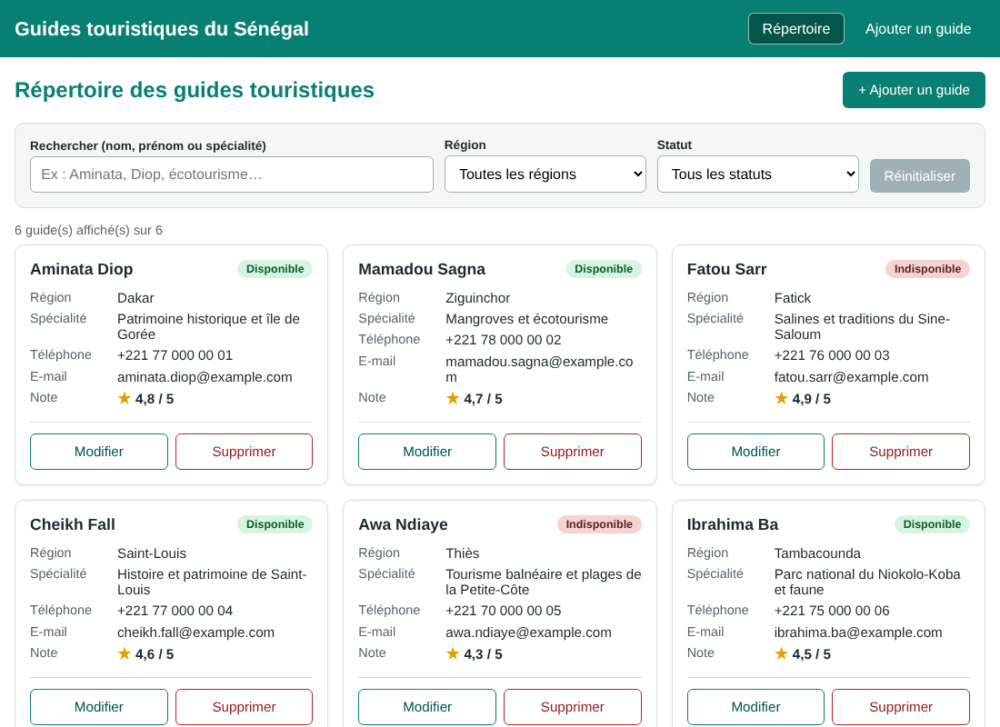

# Gestion des guides touristiques

Application Angular de gestion d'un répertoire de guides touristiques au Sénégal : consulter, rechercher, filtrer, ajouter, modifier et supprimer des fiches.
Projet d'évaluation finale — *Développement front-end*, Licence 2 Ingénierie Informatique, UASZ.

> Toutes les données sont **fictives** (aucune donnée personnelle réelle).



## Prérequis

| Outil | Version | Vérification |
|---|---|---|
| [Node.js](https://nodejs.org) | version LTS récente (compatible Angular 22) | `node --version` |
| npm | fourni avec Node.js | `npm --version` |
| [Git](https://git-scm.com) | n'importe quelle version récente | `git --version` |

Angular CLI est installé avec le projet : pas besoin de l'installer globalement (on utilise `npm start`).

**Windows / PowerShell** : si `npm` répond « l'exécution de scripts est désactivée sur ce système », tapez une fois
`Set-ExecutionPolicy -Scope CurrentUser RemoteSigned`, puis relancez la commande.

## Installation

```bash
git clone https://github.com/papaabdoulayebakhoum-netizen/gestion-guides-touristiques.git
cd gestion-guides-touristiques
npm install
```

## Lancement

```bash
npm start
```

Ouvrir <http://localhost:4200/>. L'application se recharge automatiquement quand un fichier change. `Ctrl+C` arrête le serveur.

## Autres commandes

| Commande | Rôle |
|---|---|
| `npm run build` | compile le projet dans `dist/` |
| `npm test` | lance les tests unitaires (Vitest) |

## Fonctionnalités

| Partie | Contenu | Documentation |
|---|---|---|
| A | Projet Angular, interface `GuideTouristique`, composants, service | `src/app/models/`, `src/app/services/` |
| B, C | Liste en cartes, recherche, filtres région et statut, pipe de la note, badges | [docs/README-parties-B-C.md](docs/README-parties-B-C.md) |
| D, E | Ajout, modification, suppression, validation, messages, accessibilité, limites, évolution vers une API REST | [docs/README-parties-D-E.md](docs/README-parties-D-E.md) |

## Pages de l'application

| Adresse | Écran |
|---|---|
| `/guides` | répertoire (liste, recherche, filtres, boutons Modifier / Supprimer) |
| `/guides/nouveau` | formulaire d'ajout |
| `/guides/:id/modifier` | formulaire de modification |

Captures : [liste](docs/captures/liste-des-guides.png), [validation du formulaire](docs/captures/formulaire-validation.png), [confirmation de suppression](docs/captures/confirmation-suppression.png).

## Structure

```
src/app/
├── components/
│   ├── guide-list/      liste, recherche, filtres, suppression
│   ├── guide-form/      formulaire d'ajout et de modification
│   ├── notification/    messages de succès et d'erreur
│   └── not-found/       page introuvable
├── models/              interface GuideTouristique, liste des régions
├── pipes/               pipe de formatage de la note
├── services/            GuideService (données), NotificationService (messages)
├── app.routes.ts        routes
└── app.ts / app.html    en-tête, navigation, zone des pages
```

## Bibliothèques utilisées

Uniquement les paquets standard d'Angular 22 (`@angular/core`, `common`, `forms`, `router`, `platform-browser`), RxJS et TypeScript. Tests : Vitest et jsdom. Aucune bibliothèque d'interface externe, aucune police ni image externe.

## Limites

- Les données ne sont **pas enregistrées** : un rechargement remet les guides de démonstration.
- La validation se fait **côté client** ; dans une application réelle, le serveur doit aussi tout valider.
- Pas d'authentification.

Détails et évolution possible vers une API REST : [docs/README-parties-D-E.md](docs/README-parties-D-E.md).
